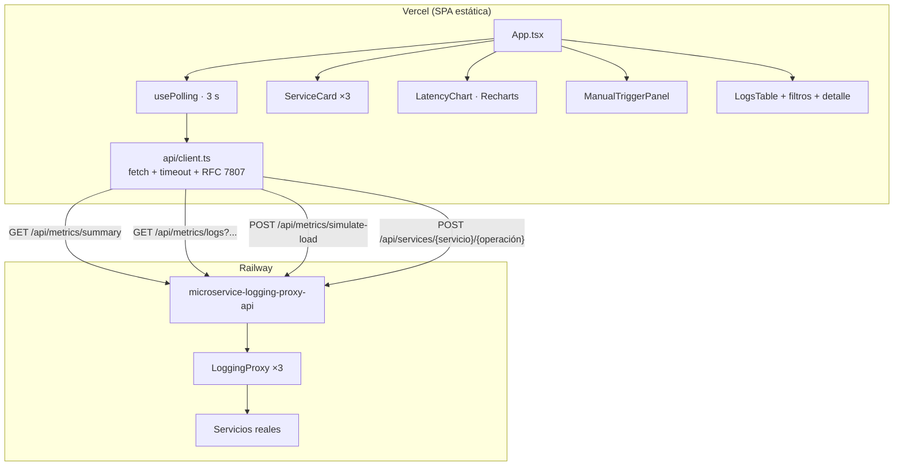

# observability-proxy-dashboard

**Sistema de monitoreo de microservicios con Proxy de auditoría y logging** — Frontend.

Dashboard de observabilidad en tiempo real (SPA en **React 18 + Vite + TypeScript + Tailwind CSS + Recharts + Lucide**) que consume la API [`Backend`](https://github.com/danielchauxgcampusucceduco/Backend), desplegada en Railway. Muestra en vivo lo que registra el **`LoggingProxy`** de cada microservicio: volumen, tasas de éxito y error, latencias, uso de caché, inicialización diferida y el detalle completo de cada llamada auditada.

> Proyecto académico — Ingeniería de Software, 4.º semestre. Tema: **Patrón de Diseño Estructural Proxy**.

---

## 1. ¿Qué muestra el dashboard?

| # | Funcionalidad | Componente |
|---|---|---|
| 1 | **Tres tarjetas de servicio** (Inventario, Pedidos, Pagos) con total de llamadas, tasa de éxito, tasa de error y tiempo promedio | `ServiceCard.tsx` |
| 2 | **Alerta de servicio degradado**: si `errorRate > 15`, la tarjeta se pone en rojo (borde brillante, fondo rojizo) con la insignia **«¡SERVICIO DEGRADADO: ERROR > 15%!»** | `ServiceCard.tsx`, `lib/services.ts` |
| 3 | **Gráfica de líneas** con las últimas 20 llamadas por servicio y su `durationMs`, tooltip detallado, leyenda interactiva y puntos rojos para los errores | `LatencyChart.tsx` |
| 4 | **Botón «Simular carga»** (50 llamadas aleatorias) y **disparador manual** por servicio/operación, con botones para simular fallos en Pagos | `DashboardHeader.tsx`, `ManualTriggerPanel.tsx` |
| 5 | **Tabla de logs en tiempo real** con *polling* cada 3 s e indicador **«En vivo · 3s»** (se puede pausar) | `LogsTable.tsx`, `LiveIndicator.tsx`, `hooks/usePolling.ts` |
| 6 | **Filtros** por servicio, estado y rango de fechas, con paginación | `LogFiltersBar.tsx`, `Pagination.tsx` |
| 7 | **Detalle expandible**: al hacer clic en una fila se ven `inputParams`, `responsePayload` y el *stack trace* resumido en bloques JSON formateados | `LogDetail.tsx`, `JsonBlock.tsx` |

Además, cada tarjeta indica si el proxy **ya instanció el servicio real** («Servicio real activo») o si sigue **en espera por carga diferida** («Lazy: en espera»), y cuántas respuestas salieron de la **caché del proxy**.

### Demo en vivo de la alerta roja

1. Pulsa **Reiniciar** para empezar con las métricas en cero.
2. Pulsa **Simular carga**: Pagos queda cerca del 10 % de error (fallo aleatorio de la pasarela).
3. En el panel **Disparador manual** pulsa **Ráfaga ×5**: se envían 5 pagos con `forceFail: true`.
4. En el siguiente ciclo de *polling* (≤ 3 s) la tarjeta de **Pagos** supera el 15 % y se pone en rojo.
5. Filtra la tabla por `PAYMENTS` + `ERROR` y haz clic en una fila para ver el error y el *stack trace*.

---

## 2. Relación con el patrón Proxy

El frontend es un cliente más de la API: nunca habla con los servicios reales, solo con los endpoints que pasan por el `LoggingProxy`. Todo lo que se ve en pantalla es información **que el proxy produce como efecto de interceptar las llamadas**:

| Lo que ves | Responsabilidad del Proxy que lo genera |
|---|---|
| `requestId`, duración, estado, fecha | Auditoría y logging |
| `inputParams` / `responsePayload` / *stack trace* | Auditoría (con datos sensibles enmascarados) |
| Llamadas `403 OPERATION_NOT_PERMITTED` | Control de acceso (proxy de protección) |
| Icono de base de datos y «aciertos de caché» | Proxy de caché |
| «Lazy: en espera» → «Servicio real activo» | Carga diferida (proxy virtual) |

**Ventajas del patrón:** control de acceso, carga diferida, caché e interfaz común (el cliente no cambia).
**Desventajas:** más complejidad, sobrecarga por llamada y diseño adicional (concurrencia, invalidación de caché).
La explicación completa, incluido el contraste **Proxy vs. Facade**, está en el README del backend.

---

## 3. Arquitectura del frontend



### Decisiones de diseño

- **Cliente HTTP centralizado** (`src/api/client.ts`): una sola URL base (`VITE_API_URL`), *timeout* con `AbortController` y conversión de errores RFC 7807 en `ApiError` con su `requestId`.
- **Polling con `setTimeout` encadenado** en lugar de `setInterval`: si la API tarda más de 3 s, las peticiones no se acumulan. Además se cancela la petición anterior al cambiar filtros (nunca se pinta una respuesta vieja) y se omiten los ciclos con la pestaña oculta.
- **La regla del 15 % también se evalúa en el cliente** (`isDegraded`), así la alerta no depende de un único campo del backend.
- **La fila expandida se identifica por `requestId`**, no por posición, para que siga abierta aunque lleguen logs nuevos en cada refresco.
- **Recharts en un *chunk* separado** (`vite.config.ts`): es la dependencia más pesada y así se cachea entre despliegues.

---

## 4. Estructura del repositorio

```
observability-proxy-dashboard/
├── index.html
├── package.json
├── vercel.json               # build Vite, fallback SPA, caché de assets, cabeceras de seguridad
├── .env.example              # VITE_API_URL
├── vite.config.ts
├── tailwind.config.js        # paleta carbón / dorado / esmeralda
├── public/favicon.svg
└── src/
    ├── main.tsx
    ├── App.tsx
    ├── index.css
    ├── api/
    │   ├── client.ts         # cliente HTTP centralizado
    │   ├── endpoints.ts      # funciones por endpoint
    │   └── types.ts          # tipos espejo de los DTO del backend
    ├── hooks/
    │   ├── usePolling.ts
    │   └── useToasts.ts
    ├── lib/
    │   ├── format.ts         # formatos es-CO, JSON legible
    │   └── services.ts       # etiquetas, colores, umbral 15 %
    └── components/
        ├── DashboardHeader.tsx   LiveIndicator.tsx   ConnectionBanner.tsx
        ├── ServiceCard.tsx       LatencyChart.tsx    ManualTriggerPanel.tsx
        ├── LogsTable.tsx         LogFiltersBar.tsx   LogDetail.tsx
        ├── JsonBlock.tsx         StatusBadge.tsx     Pagination.tsx
        └── ToastStack.tsx
```

---

## 5. Ejecución local

**Requisitos:** Node.js 18+ y el backend corriendo en `http://localhost:8080`.

```bash
npm install
```

```bash
cp .env.example .env
```

```bash
npm run dev
```

Abre `http://localhost:5173`. El backend ya permite este origen en su configuración CORS.

Compilación de producción:

```bash
npm run build
```

```bash
npm run preview
```

---

## 6. Despliegue en Vercel

> Despliega primero el backend en Railway y copia su dominio público (por ejemplo `https://microservice-logging-proxy-api-production.up.railway.app`).

1. **Sube este repositorio a GitHub** como `observability-proxy-dashboard` (independiente del backend).
2. En [vercel.com](https://vercel.com) → **Add New… → Project** → importa el repositorio.
3. Vercel detecta **Vite** gracias a `vercel.json` (*build* `npm run build`, salida `dist`). No cambies nada más.
4. En **Environment Variables** agrega:
   - `VITE_API_URL` = URL de Railway **sin barra final**.
5. Pulsa **Deploy**. Obtendrás algo como `https://observability-proxy-dashboard.vercel.app`.
6. Comprueba que el indicador muestre **«En vivo · 3s»** en verde. Si aparece «Sin conexión»:
   - Revisa que `VITE_API_URL` sea correcta. Vite la incrusta al compilar, así que después de cambiarla hay que **volver a desplegar** (*Redeploy*).
   - Revisa que la variable `CORS_ALLOWED_ORIGINS` del backend incluya tu dominio (por defecto ya acepta `https://*.vercel.app`).

### Variables de entorno

| Variable | Ejemplo | Descripción |
|---|---|---|
| `VITE_API_URL` | `https://microservice-logging-proxy-api-production.up.railway.app` | URL base del backend. En local: `http://localhost:8080` |
